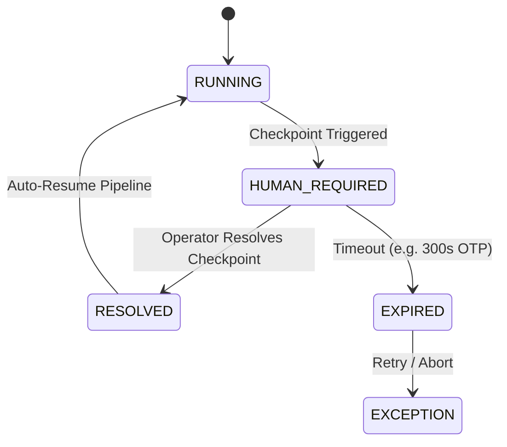

# 43 — Human Checkpoints Specification

## 1. Checkpoint Principles

TAXLA automates all deterministic steps and pauses strictly when human verification, security challenges, or statutory signoffs are required.

## 2. Supported Checkpoint Types

| Checkpoint Type | Trigger Scenario | Prompt Message | Required Role | Resolution Payload |
| :--- | :--- | :--- | :--- | :--- |
| `AADHAAR_OTP` | Portal Aadhaar verification step | "Enter the 6-digit OTP sent to registered mobile" | `OPERATOR` | `{"otp_code": "123456"}` |
| `FINAL_SUBMISSION_OTP` | Portal final submission step | "Enter the final submission OTP" | `OPERATOR` | `{"otp_code": "654321"}` |
| `CAPTCHA` | Visual portal CAPTCHA challenge | "Enter the CAPTCHA characters shown" | `OPERATOR` | `{"captcha_text": "AB12"}` |
| `DATA_REVIEW` | Extraction confidence < 0.70 or format error | "Review and correct highlighted fields" | `OPERATOR` | `{"corrected_fields": {...}}` |
| `NIC_APPROVAL` | 5-Digit NIC code suggestion generated | "Approve or select NIC 2008 5-digit activity code" | `REVIEWER` | `{"nic_code": "62011", "decision": "APPROVE"}` |
| `FINAL_APPROVAL` | Preflight passed, ready for portal | "Final sign-off before government submission" | `BRANCH_ADMIN` | `{"decision": "APPROVE"}` |
| `EXCEPTION` | Portal DOM change / network timeout | "Resolve portal exception or retry node" | `OPERATOR` | `{"action": "RETRY"}` |

## 3. Lifecycle & State Transitions

## 4. OTP Security Rules
- OTP is transmitted in memory to Redis channel `otp_{app_id}` to unblock the waiting Playwright worker.
- OTP is never written to log files, disk databases, query strings, or sent to external LLMs.
